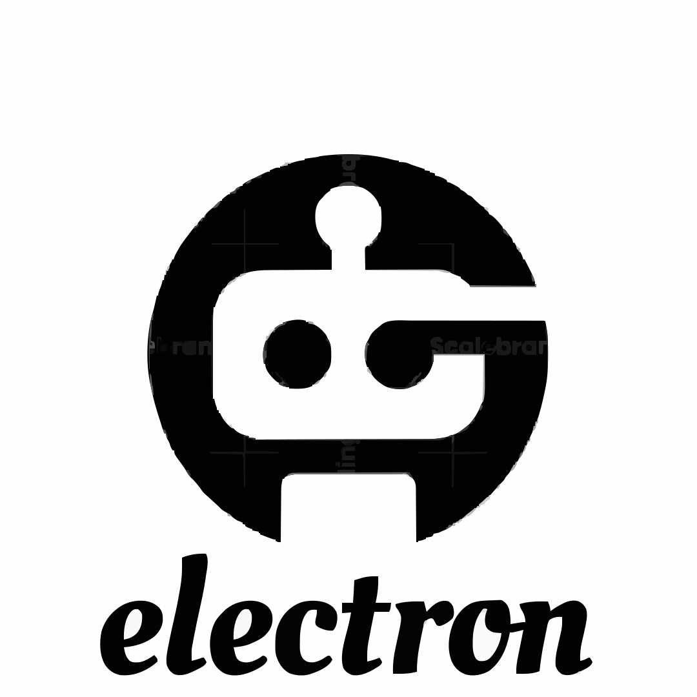
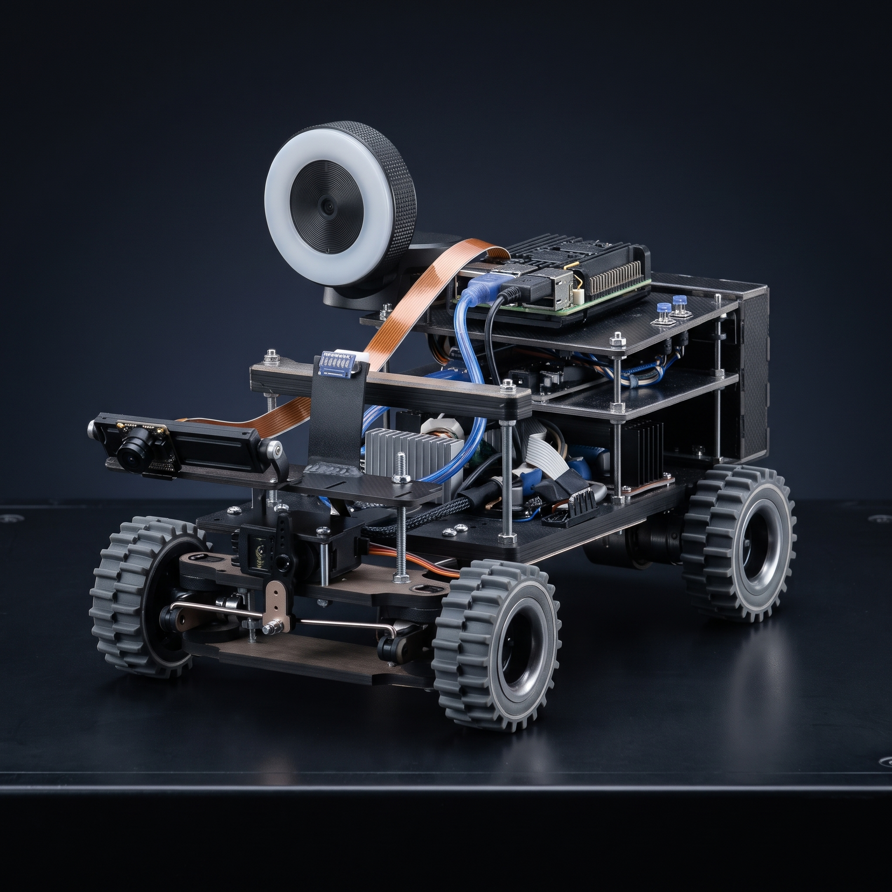
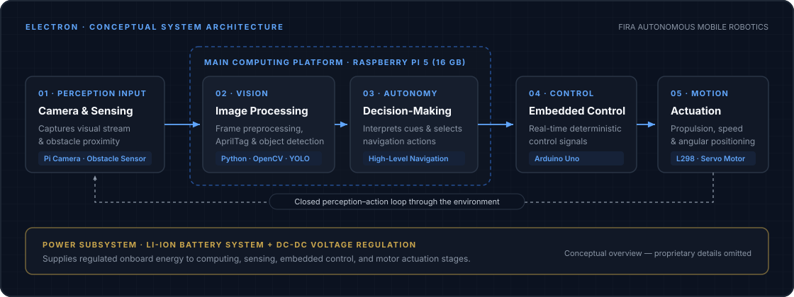

<div align="center">



# ELECTRON

### FIRA Autonomous Mobile Robotics

**2nd Place — Iran National FIRA Competition** · **Qualified — FIRA International Competition**

[**Overview**](docs/overview.md) · [**Achievements**](docs/achievements.md) · [**Hardware**](docs/hardware.md) · [**Architecture**](docs/architecture.md) · [**Team**](docs/team.md)

</div>

---

<div align="center">



</div>

---

## 1. Platform Overview

**ELECTRON** is an autonomous mobile robotics platform engineered for the **FIRA Robotics Competition**. It integrates onboard computer vision, fiducial marker decoding, real-time decision-making, and deterministic embedded control into an untethered mobile robot capable of operating without human intervention.

| Tier | Standing | Competition |
| :--- | :--- | :--- |
| **National — Iran** | **2nd Place** | Iran National FIRA Robotics Competition |
| **International** | **Qualified** | FIRA International Competition |

### Core Engineering Domains

`Autonomous Robotics` · `Computer Vision` · `Image Processing` · `Embedded Systems` · `Sensor Integration` · `Robotic Navigation` · `Object Recognition` · `Hardware / Software Integration`

---

## 2. System Architecture



1. **Sensing** — The Raspberry Pi Camera and obstacle detection sensor capture visual and proximity state from the competition course.
2. **Vision Processing (Raspberry Pi 5 · 16 GB)** — Frames are filtered and analyzed using Python, OpenCV, YOLO object detection, and AprilTag fiducial recognition.
3. **Decision-Making (Raspberry Pi 5 · 16 GB)** — Perception outputs are evaluated in real time to select navigation actions.
4. **Embedded Control (Arduino Uno)** — High-level navigation commands are translated into deterministic PWM and motor control signals.
5. **Actuation (L298 & Servo Motor)** — Drive motors and the steering servo execute propulsion and directional geometry, powered by the onboard **Li-ion Battery System** and **DC-DC Voltage Regulation** bus.

---

## 3. Hardware Stack

| Subsystem | Category | Role |
| :--- | :--- | :--- |
| **Raspberry Pi 5 (16 GB)** | Primary Compute | Central single-board computer executing camera capture, image processing, vision inference, and high-level navigation decisions. |
| **Raspberry Pi Camera** | Optical Sensor | Captures the live forward visual stream for marker recognition, object detection, and path tracking. |
| **Arduino Uno** | Embedded Controller | Microcontroller dedicated to deterministic, time-critical control loops and actuator signal generation. |
| **L298 Motor Driver** | Motor Power Stage | Dual H-bridge power stage converting low-current logic signals into regulated current for drive motor speed and direction. |
| **Servo Motor** | Precision Actuator | Closed-loop rotary actuator providing accurate angular steering positioning. |
| **Li-ion Battery System** | Energy Storage | Rechargeable lithium-ion battery pack enabling untethered autonomous operation. |
| **DC-DC Voltage Regulation** | Power Conditioning | Stabilizes battery voltage into clean supply rails for compute, sensing, and control electronics. |
| **Obstacle Detection Sensor** | Proximity Sensing | Detects physical obstacles in the robot's path for collision-safe navigation. |

---

## 4. Software & Perception

| Technology | Category | Role |
| :--- | :--- | :--- |
| **Python** | Core Runtime | Orchestrates camera acquisition, vision inference, and autonomous decision-making on the Raspberry Pi 5. |
| **OpenCV** | Vision Library | Frame capture, geometric transformation, filtering, and classical computer-vision operations. |
| **YOLO** | Deep Learning | Real-time neural object detection within the live camera stream. |
| **AprilTag (`36h11`)** | Fiducial Localization | Standardized visual fiducial markers (`36h11` family, IDs `0–5`, `0.05 m` tag size) decoded for navigation directives and traffic-related instructions. |
| **Image Processing** | Signal Pipeline | Frame preprocessing, noise reduction, and feature extraction prior to downstream inference. |
| **Embedded Systems** | Deterministic I/O | Low-level firmware on the Arduino Uno managing PWM generation and motor driver interfacing. |

---

## 5. Team & Engineering

| Name | Role |
| :--- | :--- |
| **Amirali Noorani** | Team Member |
| **Matin Fakhim** | Team Member |
| **Hamidreza Ramezani** | Team Coach |

### Engineering Focus — Amirali Noorani

`Robotics Software Development` · `Computer Vision & Object Recognition` · `Image Processing Pipelines` · `Raspberry Pi 5 System Integration` · `Embedded Control Interfacing` · `Hardware / Software Co-Design` · `System Testing & Calibration` · `Debugging & Runtime Optimization`

---

## 6. Repository Structure

```text
electron-fira-autonomous-car/
├── index.html                  # Portfolio website entry point (English · LTR)
├── css/
│   └── style.css               # Dark Professional Engineering design system
├── js/
│   └── app.js                  # Navigation, scroll spy, reveal motion, and image viewer
├── assets/
│   ├── images/
│   │   ├── robot-hero.png      # Primary 1:1 studio photograph of the ELECTRON robot
│   │   └── robot-hero.jpg      # Compressed studio photograph
│   ├── diagrams/
│   │   └── architecture.svg    # High-level conceptual system architecture diagram
│   ├── fonts/                  # Bundled Inter variable font (WOFF2 + SIL OFL 1.1)
│   └── icons/
│       └── favicon.svg         # ELECTRON orbital emblem
├── docs/
│   ├── overview.md             # Platform overview
│   ├── achievements.md         # Competition standing
│   ├── hardware.md             # Hardware subsystem specifications
│   ├── architecture.md         # Software & perception architecture
│   └── team.md                 # Team roster & engineering focus
├── .github/
│   └── workflows/
│       └── pages.yml           # GitHub Actions static deployment workflow
├── LICENSE-NOTICE.md           # Confidentiality & intellectual property notice
├── robots.txt                  # Crawler directives
└── sitemap.xml                 # XML sitemap
```

---

## 7. Confidentiality Notice

In accordance with FIRA competition confidentiality requirements, the robot's source code, trained model weights, control parameters, and proprietary competition strategies are intentionally withheld from this repository. See [`LICENSE-NOTICE.md`](LICENSE-NOTICE.md) for full details.

---

<div align="center">

© 2026 ELECTRON Robotics Team · FIRA Autonomous Mobile Robotics

</div>
