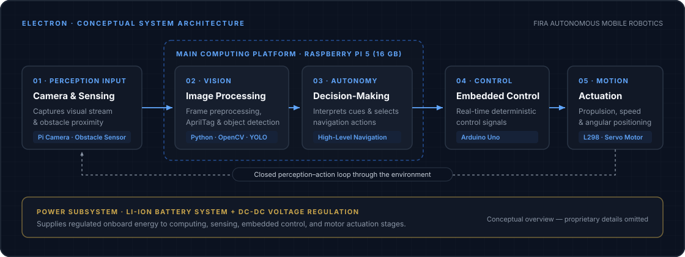

# Software & System Architecture — ELECTRON

[Back to Repository Root](../README.md) · [Overview](overview.md) · [Achievements](achievements.md) · [Hardware](hardware.md) · [Team](team.md)

---

## Conceptual Pipeline

The **ELECTRON** platform operates as a closed perception–action loop across five stages:

1. **Sensing** — The Raspberry Pi Camera and obstacle detection sensor capture visual and proximity state from the competition environment.
2. **Vision Processing (Raspberry Pi 5)** — Frames are filtered and analyzed using OpenCV, YOLO object detection, and AprilTag fiducial recognition.
3. **Decision-Making (Raspberry Pi 5)** — Perception outputs are evaluated to select real-time navigation commands.
4. **Embedded Control (Arduino Uno)** — High-level navigation commands are translated into deterministic PWM and motor control signals.
5. **Actuation (L298 & Servo Motor)** — Drive motors and the steering servo execute propulsion and directional control, supported by the **Li-ion Battery + DC-DC Voltage Regulation** power bus.

---

## Software & Perception Stack

| Technology | Category | Role |
| :--- | :--- | :--- |
| **Python** | Core Runtime | High-level orchestration of camera capture, computer-vision inference, and autonomous decision-making on the Raspberry Pi 5. |
| **OpenCV** | Vision Library | Real-time image acquisition, geometric transformation, filtering, and classical computer-vision routines. |
| **YOLO** | Deep Learning | Real-time neural object detection within the live camera stream. |
| **AprilTag (`36h11`)** | Fiducial Localization | Standardized visual fiducial markers (`36h11` family, IDs `0–5`, `0.05 m` tag size) decoded for navigation directives and traffic-related instructions. |
| **Image Processing** | Signal Pipeline | Frame preprocessing, noise reduction, and feature extraction prior to downstream detection. |
| **Embedded Systems** | Deterministic Control | Microcontroller firmware on the Arduino Uno managing low-level actuator timing and motor driver interfacing. |

---

## Confidentiality Notice

Source code, trained model weights, control parameters, and proprietary algorithms are intentionally withheld in accordance with FIRA competition confidentiality requirements.
