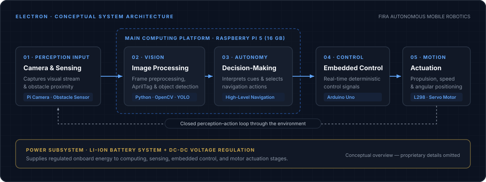

# Software & System Architecture — ELECTRON

[English](architecture.md) · [فارسی](../fa/architecture.md) · [Back to Repository Root](../../README.md)

---

## Conceptual System Architecture

The **ELECTRON** robot follows a five-stage perception-to-action pipeline operating in a closed loop with its environment:

1. **Camera & Sensing** — The Raspberry Pi Camera and obstacle detection sensor capture visual and proximity information from the competition field.
2. **Image Processing (Raspberry Pi 5)** — Raw camera frames are preprocessed and analyzed to extract geometric, color, and marker features.
3. **Decision-Making (Raspberry Pi 5)** — Perception outputs are evaluated to select the appropriate navigation action.
4. **Embedded Control (Arduino Uno)** — High-level navigation commands are translated into deterministic, real-time control signals.
5. **Actuation (L298 Motor Driver & Servo Motor)** — Drive motors and the servo actuator execute propulsion, speed, and angular adjustments, while the **Power Subsystem** (Li-ion Battery + DC-DC Voltage Regulation) supplies stable energy across all stages.

---

## Software & Technology Stack

| Technology | Category | Role in the ELECTRON Robot |
| :--- | :--- | :--- |
| **Python** | Programming Language | Primary language for high-level perception, coordination, and decision-making on the Raspberry Pi 5. |
| **OpenCV** | Computer Vision Library | Frame capture, image preprocessing, filtering, and classical computer-vision operations. |
| **YOLO** | Object Detection | Real-time deep-learning object recognition within the live camera stream. |
| **Computer Vision** | Perception | Scene interpretation, visual cue extraction, and fiducial marker recognition. |
| **AprilTag** | Fiducial Marker System | Standardized visual fiducial markers (family `36h11`) used for navigation and traffic-related instructions. |
| **Image Processing** | Signal Processing | Transforming raw camera frames into clean, actionable representations for downstream detectors. |
| **Embedded Systems** | Real-Time Control | Microcontroller software on the Arduino Uno managing low-level actuator timing and motor driver interfacing. |
| **Autonomous Robotics** | System Integration | Coordinating perception, decision-making, and embedded actuation in a closed feedback loop. |

---

## Engineering Challenges (Pending Team Verification)

The following engineering challenge categories are tracked for documentation once specific competition-safe details are confirmed by the team:

- **01 · Sensor Reliability** — _Pending verification_
- **02 · Navigation** — _Pending verification_
- **03 · Environmental Interference** — _Pending verification_
- **04 · Computer Vision Performance** — _Pending verification_
- **05 · Real-Time Processing** — _Pending verification_
- **06 · Hardware Integration** — _Pending verification_
- **07 · System Stability** — _Pending verification_

---

## Confidentiality Notice

To comply with FIRA competition confidentiality requirements, the robot's source code, trained model weights, control parameters, and proprietary algorithms are intentionally not published in this repository.

---

## Documentation Index

- [Project Overview](overview.md)
- [Competition Achievements](achievements.md)
- [Hardware Architecture](hardware.md)
- [Software & System Architecture](architecture.md)
- [Team & Personal Contributions](team.md)
