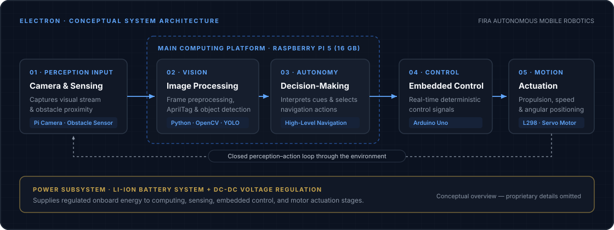

# نرم‌افزار و معماری سامانه — ELECTRON

[English](../en/architecture.md) · [فارسی](architecture.md) · [بازگشت به صفحه‌ی اصلی مخزن](../../README.md)

---

## معماری مفهومی سامانه

ربات **ELECTRON** از یک خط لوله‌ی پنج‌مرحله‌ای از ادراک تا عمل در یک حلقه‌ی بسته با محیط پیروی می‌کند:

1. **دوربین و حسگرها** — دوربین Raspberry Pi و حسگر تشخیص مانع، اطلاعات تصویری و مجاورتی زمین مسابقه را دریافت می‌کنند.
2. **پردازش تصویر (Raspberry Pi 5)** — فریم‌های خام دوربین پیش‌پردازش و تحلیل می‌شوند تا ویژگی‌های هندسی، رنگی و نشانگرها استخراج گردند.
3. **تصمیم‌گیری (Raspberry Pi 5)** — خروجی‌های ادراک برای انتخاب اقدام مناسب ناوبری ارزیابی می‌شوند.
4. **کنترل نهفته (Arduino Uno)** — فرمان‌های سطح بالای ناوبری به سیگنال‌های کنترلی دقیق و بلادرنگ تبدیل می‌شوند.
5. **محرکه (درایور موتور L298 و سروو موتور)** — موتورهای حرکتی و سروو موتور پیشرانش، سرعت و تنظیم زاویه را اجرا می‌کنند، در حالی که **زیرسامانه‌ی تأمین انرژی** (باتری لیتیوم-یون + تنظیم ولتاژ DC-DC) توان پایدار همه‌ی بخش‌ها را فراهم می‌سازد.

---

## پشته‌ی نرم‌افزاری و فناوری‌ها

| فناوری | دسته‌بندی | نقش در ربات ELECTRON |
| :--- | :--- | :--- |
| **Python** | زبان برنامه‌نویسی | زبان اصلی برای ادراک سطح بالا، هماهنگی و تصمیم‌گیری بر روی Raspberry Pi 5. |
| **OpenCV** | کتابخانه‌ی بینایی ماشین | دریافت فریم، پیش‌پردازش تصویر، پالایش و عملیات کلاسیک بینایی ماشین. |
| **YOLO** | شناسایی اشیا | تشخیص بلادرنگ اشیا مبتنی بر یادگیری عمیق در جریان تصویر دوربین. |
| **بینایی ماشین** | ادراک | تفسیر صحنه، استخراج نشانه‌های تصویری و تشخیص نشانگرهای استاندارد. |
| **AprilTag** | سامانه‌ی نشانگر تصویری | نشانگرهای تصویری استاندارد (خانواده‌ی `36h11`) برای ناوبری و دستورالعمل‌های ترافیکی. |
| **پردازش تصویر** | پردازش سیگنال | تبدیل فریم‌های خام دوربین به داده‌های پالایش‌شده و قابل استفاده برای بخش‌های تصمیم‌گیری. |
| **سامانه‌های نهفته** | کنترل بلادرنگ | نرم‌افزار ریزکنترل‌گر بر روی Arduino Uno برای مدیریت زمان‌بندی محرک‌ها و رابط درایور موتور. |
| **رباتیک خودران** | یکپارچه‌سازی سامانه | هماهنگ‌سازی ادراک، تصمیم‌گیری و محرکه‌ی نهفته در یک حلقه‌ی بازخورد بسته. |

---

## چالش‌های مهندسی (در انتظار تأیید تیم)

محورهای چالش مهندسی زیر پس از تأیید جزئیات قابل انتشار توسط تیم مستندسازی خواهند شد:

- **۰۱ · قابلیت اطمینان حسگرها** — _در انتظار تأیید_
- **۰۲ · ناوبری** — _در انتظار تأیید_
- **۰۳ · تداخل‌های محیطی** — _در انتظار تأیید_
- **۰۴ · عملکرد بینایی ماشین** — _در انتظار تأیید_
- **۰۵ · پردازش بلادرنگ** — _در انتظار تأیید_
- **۰۶ · یکپارچه‌سازی سخت‌افزار** — _در انتظار تأیید_
- **۰۷ · پایداری سامانه** — _در انتظار تأیید_

---

## اطلاعیه‌ی محرمانگی

در راستای رعایت الزامات محرمانگی مسابقات FIRA، کد منبع ربات، وزن مدل‌های آموزش‌دیده، پارامترهای کنترلی و الگوریتم‌های اختصاصی عمداً در این مخزن منتشر نشده‌اند.

---

## فهرست مستندات

- [معرفی پروژه](overview.md)
- [افتخارات مسابقات](achievements.md)
- [معماری سخت‌افزار](hardware.md)
- [نرم‌افزار و معماری سامانه](architecture.md)
- [تیم و مشارکت‌های فردی](team.md)

